<!-- README is generated from git history. Push code; do not edit this file. -->

<!--START_SECTION:header-->
<p align="center">
  
</p>

<h1 align="center">Learning Journey</h1>

<p align="center"><sub>The Odin Project · Learning in public · India (IST)</sub></p>

<p align="center">
  
</p>

<p align="center">
  <strong>Currently learning:</strong> Getting started<br />
  <sub>Last commit: 15 Nov 2026 · 09:28 IST</sub>
</p>
<!--END_SECTION:header-->

<!--START_SECTION:roadmap-->
## Roadmap

<p align="center">
  
</p>
<!--END_SECTION:roadmap-->

<!--START_SECTION:courses-->
## Course Progress

| Course | Status | Work | Progress |
|:--|:--:|:--|:--|
| [💎 **Ruby**](https://www.theodinproject.com/paths/full-stack-ruby-on-rails/courses/ruby) | ⬜ Not started | — | `░░░░░░░░░░░░░░░░░░░░` 0% |
| [🎨 **Intermediate HTML and CSS**](https://www.theodinproject.com/paths/full-stack-ruby-on-rails/courses/intermediate-html-and-css) | ⬜ Not started | — | `░░░░░░░░░░░░░░░░░░░░` 0% |
| [🗄️ **Databases**](https://www.theodinproject.com/paths/full-stack-ruby-on-rails/courses/databases) | ⬜ Not started | — | `░░░░░░░░░░░░░░░░░░░░` 0% |
| [🛤️ **Ruby on Rails**](https://www.theodinproject.com/paths/full-stack-ruby-on-rails/courses/ruby-on-rails) | ⬜ Not started | — | `░░░░░░░░░░░░░░░░░░░░` 0% |
| [✨ **Advanced HTML and CSS**](https://www.theodinproject.com/paths/full-stack-ruby-on-rails/courses/advanced-html-and-css) | ⬜ Not started | — | `░░░░░░░░░░░░░░░░░░░░` 0% |
| [⚡ **JavaScript**](https://www.theodinproject.com/paths/full-stack-ruby-on-rails/courses/javascript) | ⬜ Not started | — | `░░░░░░░░░░░░░░░░░░░░` 0% |
| [⚛️ **React**](https://www.theodinproject.com/paths/full-stack-ruby-on-rails/courses/react) | ⬜ Not started | — | `░░░░░░░░░░░░░░░░░░░░` 0% |
| [🤝 **Getting Hired**](https://www.theodinproject.com/paths/full-stack-ruby-on-rails/courses/getting-hired) | ⬜ Not started | — | `░░░░░░░░░░░░░░░░░░░░` 0% |

<sub>The newest folder in a course is in progress; older folders count as done. Courses before your current course are done.</sub>
<!--END_SECTION:courses-->

<!--START_SECTION:stats-->
## Stats

| Current streak | Best streak | Active days |
|:---:|:---:|:---:|
| **2 days** | **2 days** | **2** |
| Commits | Study hours | Fixes |
| **4** | **0 h** | **0** |

<sub>IST days, with a one-day grace for today. Add `[1h]` to a commit message to count study hours. Fixes are commits containing `fix`.</sub>
<!--END_SECTION:stats-->

<!--START_SECTION:heatmap-->
## Activity

**Last 16 weeks** · 27 Jul 2026 → 15 Nov 2026

```text
Mon  ⬜⬜⬜⬜⬜⬜⬜⬜⬜⬜⬜⬜⬜⬜⬜⬜
Tue  ⬜⬜⬜⬜⬜⬜⬜⬜⬜⬜⬜⬜⬜⬜⬜⬜
Wed  ⬜⬜⬜⬜⬜⬜⬜⬜⬜⬜⬜⬜⬜⬜⬜⬜
Thu  ⬜⬜⬜⬜⬜⬜⬜⬜⬜⬜⬜⬜⬜⬜⬜⬜
Fri  ⬜⬜⬜⬜⬜⬜⬜⬜⬜⬜⬜⬜⬜⬜⬜⬜
Sat  ⬜⬜⬜⬜⬜⬜⬜⬜⬜⬜⬜⬜⬜⬜⬜🟩
Sun  ⬜⬜⬜⬜⬜⬜⬜⬜⬜⬜⬜⬜⬜⬜⬜🟩
```

<sub>⬜ none · 🟩 1–2 commits · 🟨 3–5 · 🟧 6+ · `·` future · one cell = one IST day</sub>
<!--END_SECTION:heatmap-->

<!--START_SECTION:recent-->
## Recent Work

_No work folders yet. Push code inside a course folder and it appears here._
<!--END_SECTION:recent-->

<!--START_SECTION:milestones-->
## Milestones

### Courses
- [ ] 💎 Ruby
- [ ] 🎨 Intermediate HTML and CSS
- [ ] 🗄️ Databases
- [ ] 🛤️ Ruby on Rails
- [ ] ✨ Advanced HTML and CSS
- [ ] ⚡ JavaScript
- [ ] ⚛️ React
- [ ] 🤝 Getting Hired

### Streaks
- [ ] 7-day streak
- [ ] 30-day streak
- [ ] 100-day streak

<sub>0/8 courses · best streak 2 days</sub>
<!--END_SECTION:milestones-->
