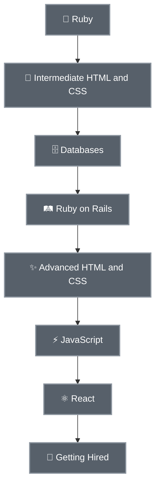

<!-- README is generated from git history. Push code; do not edit this file. -->

<!--START_SECTION:header-->
<p align="center">
  
</p>

<h1 align="center">Odin_RubyOnRails 🛤️</h1>

<p align="center">
  
</p>

<p align="center">
  
  
  
  
  
</p>

<p align="center">
  <sub><strong>0/8 courses</strong> · <strong>6 projects</strong> · <strong>1 day streak</strong> · <strong>1 commit</strong><br />
  Last commit: 14 Nov 2026 · 21:40 IST · no README editing required</sub>
</p>
<!--END_SECTION:header-->

<!--START_SECTION:roadmap-->
## 🗺️ Roadmap



<sub>✅ Done · 🚧 Current · ⬜ Not started</sub>

<sub>Order: 01 Ruby → 02 Intermediate HTML and CSS → 03 Databases → 04 Ruby on Rails → 05 Advanced HTML and CSS → 06 JavaScript → 07 React → 08 Getting Hired</sub>
<!--END_SECTION:roadmap-->

<!--START_SECTION:courses-->
## 📊 Courses

| Course | Status | Activity | Progress |
|:--|:--:|:--|:--|
| [💎 **Ruby**](https://www.theodinproject.com/paths/full-stack-ruby-on-rails/courses/ruby) | ⬜ Not started | — | `░░░░░░░░░░░░░░░░░░░░` 0% |
| [🎨 **Intermediate HTML and CSS**](https://www.theodinproject.com/paths/full-stack-ruby-on-rails/courses/intermediate-html-and-css) | ⬜ Not started | — | `░░░░░░░░░░░░░░░░░░░░` 0% |
| [🗄️ **Databases**](https://www.theodinproject.com/paths/full-stack-ruby-on-rails/courses/databases) | ⬜ Not started | — | `░░░░░░░░░░░░░░░░░░░░` 0% |
| [🛤️ **Ruby on Rails**](https://www.theodinproject.com/paths/full-stack-ruby-on-rails/courses/ruby-on-rails) | ⬜ Not started | — | `░░░░░░░░░░░░░░░░░░░░` 0% |
| [✨ **Advanced HTML and CSS**](https://www.theodinproject.com/paths/full-stack-ruby-on-rails/courses/advanced-html-and-css) | ⬜ Not started | — | `░░░░░░░░░░░░░░░░░░░░` 0% |
| [⚡ **JavaScript**](https://www.theodinproject.com/paths/full-stack-ruby-on-rails/courses/javascript) | ⬜ Not started | — | `░░░░░░░░░░░░░░░░░░░░` 0% |
| [⚛️ **React**](https://www.theodinproject.com/paths/full-stack-ruby-on-rails/courses/react) | ⬜ Not started | — | `░░░░░░░░░░░░░░░░░░░░` 0% |
| [🤝 **Getting Hired**](https://www.theodinproject.com/paths/full-stack-ruby-on-rails/courses/getting-hired) | ⬜ Not started | — | `░░░░░░░░░░░░░░░░░░░░` 0% |

<sub>No extra files needed. The folder you touched most recently in a course is in progress; older folders count as done. Courses before your current course are done.</sub>
<!--END_SECTION:courses-->

<!--START_SECTION:stats-->
## 📈 Stats

| 🔥 Current streak | 🏆 Best streak | 📅 Active days |
|:---:|:---:|:---:|
| **1 day** | **1 day** | **1** |
| 💬 Commits | ⏱️ Study hours | 🛠️ Fixes |
| **1** | **0 h** | **0** |

<sub>IST days, with a 1-day grace for today. Study hours are optional: put `[1h]` in a commit message if you want them counted. Fixes are commits containing `fix`.</sub>
<!--END_SECTION:stats-->

<!--START_SECTION:heatmap-->
## 🌱 Activity

**Last 16 weeks** · 27 Jul 2026 → 14 Nov 2026

```text
Mon  ⬜⬜⬜⬜⬜⬜⬜⬜⬜⬜⬜⬜⬜⬜⬜⬜
Tue  ⬜⬜⬜⬜⬜⬜⬜⬜⬜⬜⬜⬜⬜⬜⬜⬜
Wed  ⬜⬜⬜⬜⬜⬜⬜⬜⬜⬜⬜⬜⬜⬜⬜⬜
Thu  ⬜⬜⬜⬜⬜⬜⬜⬜⬜⬜⬜⬜⬜⬜⬜⬜
Fri  ⬜⬜⬜⬜⬜⬜⬜⬜⬜⬜⬜⬜⬜⬜⬜⬜
Sat  ⬜⬜⬜⬜⬜⬜⬜⬜⬜⬜⬜⬜⬜⬜⬜🟩
Sun  ⬜⬜⬜⬜⬜⬜⬜⬜⬜⬜⬜⬜⬜⬜⬜·
```

<sub>⬜ none · 🟩 1–2 commits · 🟨 3–5 · 🟧 6+ · `·` future · one cell = one IST day</sub>
<!--END_SECTION:heatmap-->

<!--START_SECTION:recent-->
## 🕒 Recently active

_Push your first code folder and it appears here._
<!--END_SECTION:recent-->

<!--START_SECTION:projects-->
## 🚀 Projects

| Project | Language | Stars | Updated |
|:--|:--:|:--:|:--:|
| 🚀 **[Dsa-cpp](https://github.com/zeditya/Dsa-cpp)** | — | ⭐ 0 | 14 Nov 2026 |
| 🚀 **[hue-massacre](https://github.com/zeditya/hue-massacre)** | 🎮 GDScript | ⭐ 0 | 21 Oct 2026 |
| 🚀 **[zeditya](https://github.com/zeditya/zeditya)** | — | ⭐ 1 | 15 Oct 2026 |
| 🚀 **[DAA-LAB](https://github.com/zeditya/DAA-LAB)** | 🔧 C | ⭐ 0 | 13 Aug 2026 |
| 🚀 **[WEBSPRINT2026](https://github.com/zeditya/WEBSPRINT2026)** | 🌐 HTML | ⭐ 0 | 8 Jun 2026 |
| 🚀 **[Food_court_management_system](https://github.com/zeditya/Food_court_management_system)** | 🐍 Python | ⭐ 0 | 4 May 2026 |

<sub>Discovered from your public GitHub repos · forks and this repo are skipped · edit `PROJECT_EXCLUDE` in the script to hide one.</sub>
<!--END_SECTION:projects-->

<!--START_SECTION:milestones-->
## 🎯 Milestones

### 🎓 Courses
- [ ] 💎 Ruby
- [ ] 🎨 Intermediate HTML and CSS
- [ ] 🗄️ Databases
- [ ] 🛤️ Ruby on Rails
- [ ] ✨ Advanced HTML and CSS
- [ ] ⚡ JavaScript
- [ ] ⚛️ React
- [ ] 🤝 Getting Hired

### 🔥 Streaks
- [ ] 7-day streak
- [ ] 30-day streak
- [ ] 100-day streak

### 📦 Shipping
- [x] First project
- [x] 3 projects
- [x] 5 projects
- [ ] 10 projects

<sub>0/8 courses · best streak 1 day · 6 projects</sub>
<!--END_SECTION:milestones-->
